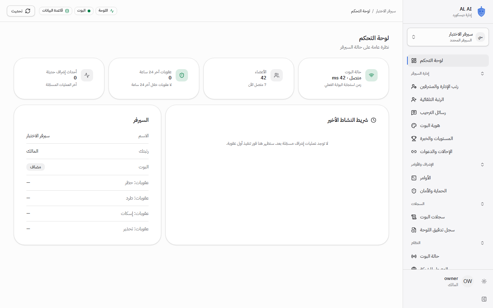
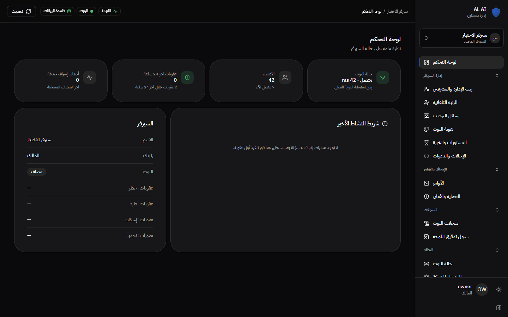
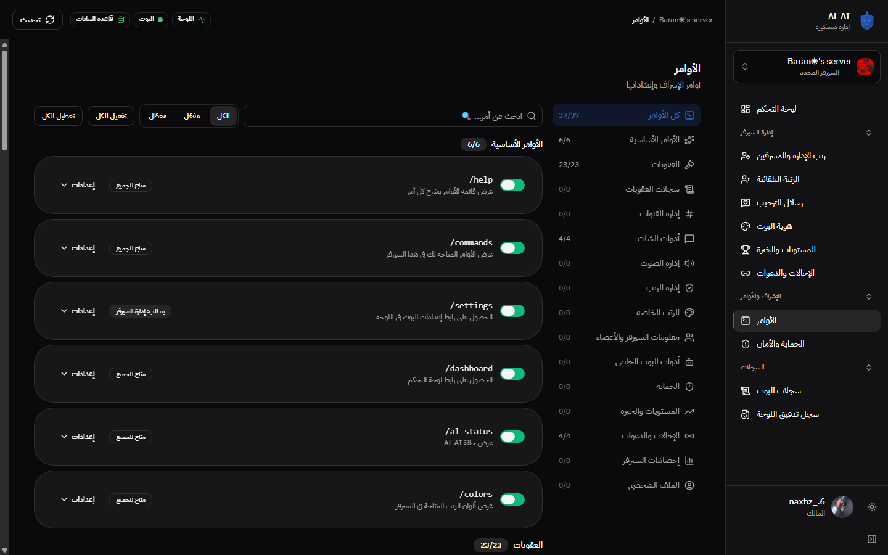
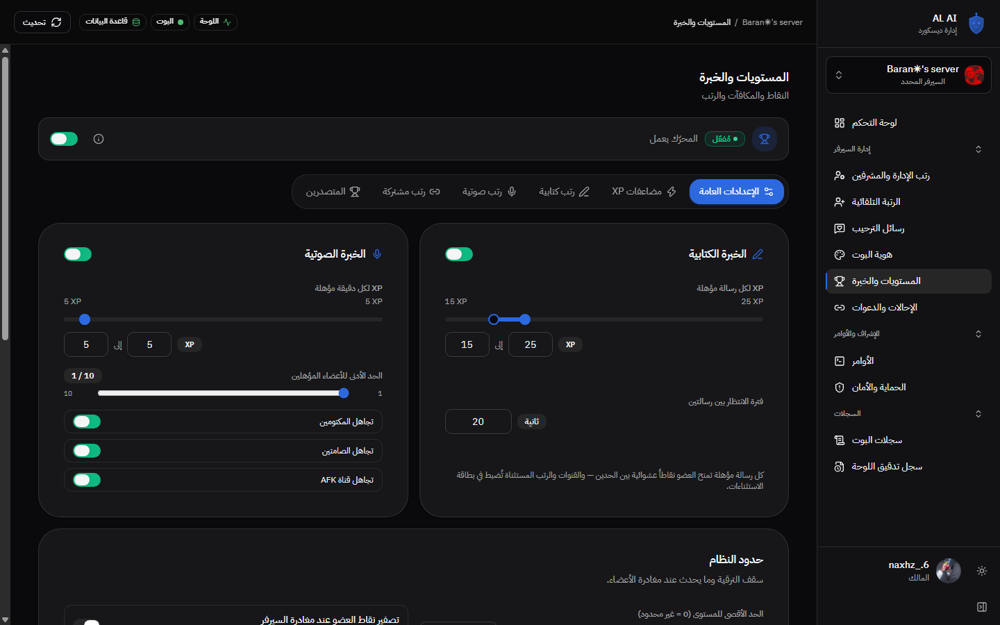
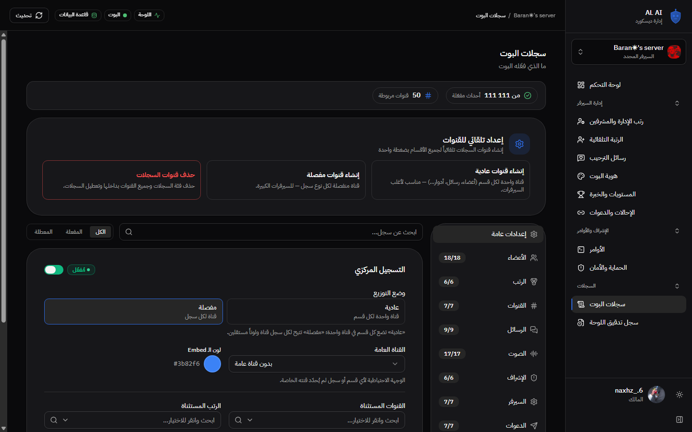
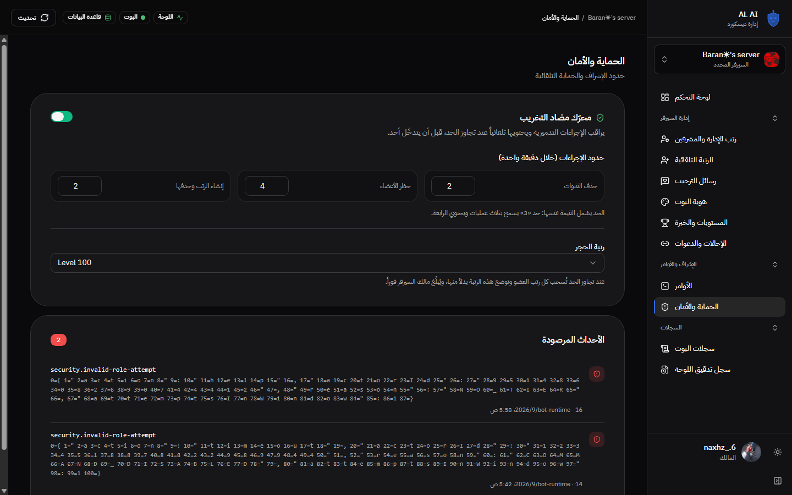
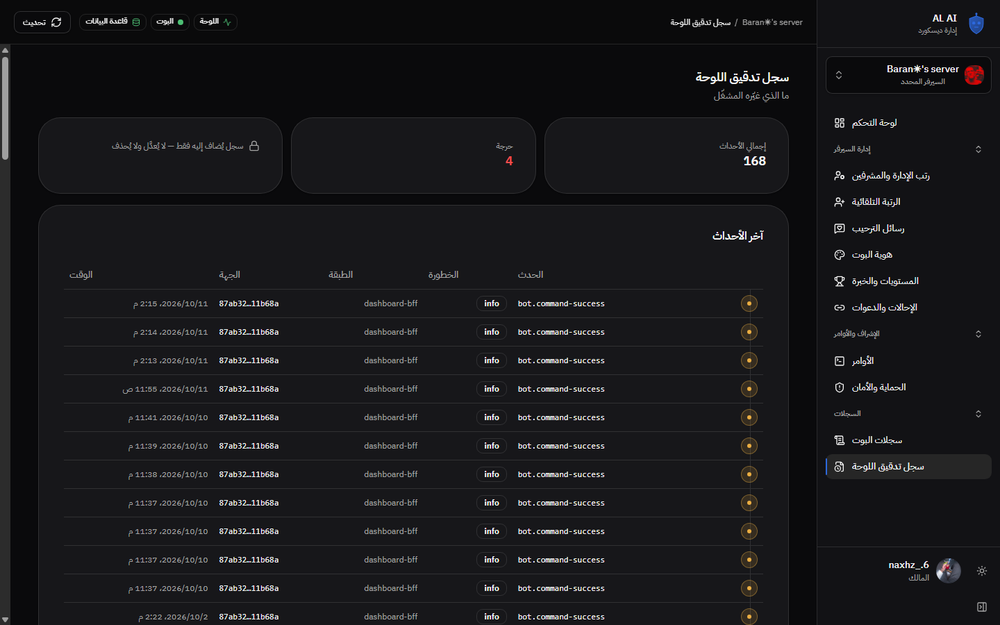
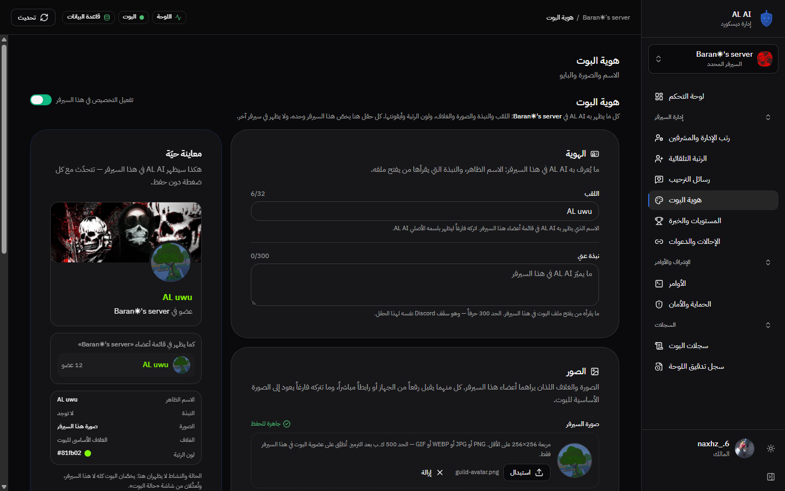
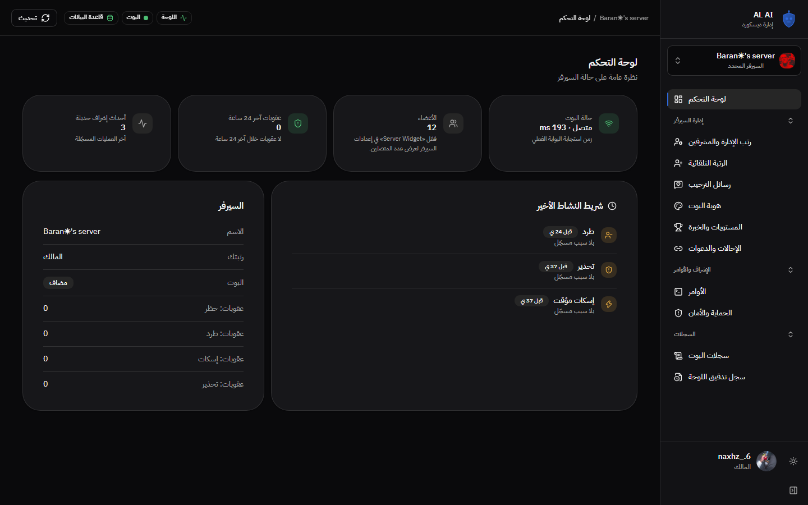
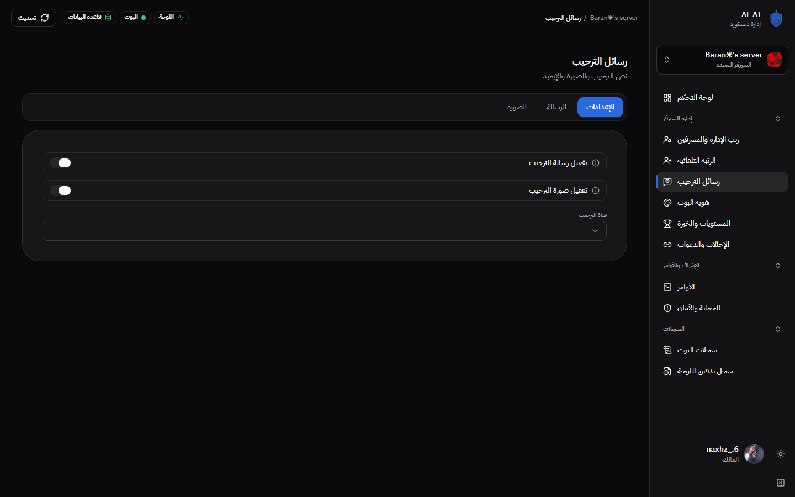

# كتاب AL AI — الدليل المصوّر للمنصة

> بوت ديسكورد لإدارة السيرفرات + لوحة تحكم آمنة، عربي RTL بالكامل.
> كل صورة في هذا الكتاب **لقطة حقيقية** من لوحة تعمل فيها (وليس نموذجاً).
> المستودع: `github.com/Steve6546/al-ai` · آخر تحديثات موثّقة في `README.md`.

---

## 1. ما الذي تبنيه المنصة

| | |
|---|---|
| **المشغّل** |discord.js واحد، اتصال Gateway واحد، قفل نسخة واحدة، بودايم واحد موحّد |
| **اللوحة** | Fastify BFF + واجهة React RTL؛ **لا يصل أي سرّ إلى المتصفّح** |
| **العقد** | `packages/core`: مخطّط الأحداث، الصلاحيات، التشفير، سياسة الجلسة، تطبيع المظهر |
| **البيانات** | PostgreSQL 17 على `55432`، 24 جدولاً، سجل تدقيق **إضافة فقط** مشفّر AES-256-GCM |

الفصل: المتصفّح يتحدّث مع الـBFF فقط (كوكي `HttpOnly`)، والـBFF وحده هو من يتحدّث مع ديسكورد
ويكتب في القاعدة. لا يلمس البوتُ اللوحة، ولا تمسّ اللوحةُ البوت.

```
┌──────────────────────┐
│  Browser (RTL SPA)   │  React 19 + Vite — no token ever reaches it
│  apps/dashboard/src  │
└──────────┬───────────┘
           │ same-origin fetch, httpOnly session cookie
           ▼
┌──────────────────────┐        ┌──────────────────────────────┐
│   Fastify BFF :3000  │───────▶│  PostgreSQL :55432           │
│  apps/dashboard/     │  SQL   │  guilds, logging, commands,  │
│  server/             │        │  bot_identity, audit trail   │
│  • session + tier    │        └──────────────────────────────┘
│  • TtlCache 60s      │        ┌──────────────────────────────┐
│  • RequestThrottle   │───────▶│  Discord REST API v10        │
│  • appearance writer │  HTTPS │  (the BFF is the only writer│
└──────────┬───────────┘        │   of every appearance field) │
           ▲                    └──────────────────────────────┘
           │ signed HMAC heartbeat every 30s
┌──────────┴───────────┐        ┌──────────────┴───────────────┐
│ Integration adapter  │        │  Discord Gateway (WebSocket) │
│ 127.0.0.1:3400       │◀───────│  apps/bot/src/lib/discord.ts │
│ inbound reads only   │        └──────────────────────────────┘
└──────────────────────┘
```

---

## 2. مساحة العمل

```
apps/bot        ← بوت ديسكورد: البوابة، الأوامر، الإشراف، المستويات، الترحيب
apps/dashboard  ← اللوحة: الواجهة + الـBFF (منفصلان في نفس المساحة)
packages/core   ← العقود المشتركة: مخطّط الأحداث، الصلاحيات، التشفير، الجلسة
infra           ← ملفات Docker، docker-compose، ومخطّط قاعدة البيانات
scripts         ← أدوات التشغيل والتحقق (PowerShell + Node)
docs            ← هذا الكتاب + [GOVERNANCE.md](GOVERNANCE.md) (٢٧ قاعدة)
```

**قاعدة الفصل:** `core` لا يستورد إلا `node:crypto`؛ الواجهة لا تصل إلى البوت ولا إلى الخادم؛
البوت لا يصل إلى اللوحة؛ ولا دورات استيراد. `discord.js` في ملف واحد فقط.

---

## 3. اللوحة: الهيكل والتنقّل

الشاشة frame واحدة: قائمة جانبية + رأس + منطقة تمرير **واحدة** لكل شاشة
(`html, body, #root { height: 100dvh; overflow: hidden }`)، والمحتوى وحده هو الذي يتمرّر.



### مجموعات القائمة

| المجموعة | ما فيها |
|---|---|
| **الرئيسية** | لوحة التحكم — نظرة عامة على حالة السيرفر |
| **إدارة السيرفر** | رتب الإدارة والمشرفين · الرتبة التلقائية · رسائل الترحيب · هوية البوت · المستويات والخبرة · الإحالات والدعوات |
| **الإشراف والأوامر** | الأوامر · الحماية والأمان |
| **السجلات** | سجلات البوت · سجل تدقيق اللوحة |
| **النظام** (للمالك فقط) | حالة البوت · الوصول للشبكة |

كل شاشة تظهر **مرة واحدة**، والمجموعة تُفتح وتُغلق، والقائمة تطوى إلى **rail** أيقونات على سطح المكتب
(تفضيل محفوظ على الجهاز). البند النشط يُعلَّم بخط جانبي ولون العلامة.

### الرأس

مسار تنقّل (السيرفر › القسم) + **ثلاث شارات منفصلة**: اللوحة، البوت، قاعدة البيانات — كل واحدة من
`/api/health` الحقيقية. لا «متصل» إلا من نتيجة خادم.

زر التحديث **يعيد جلب البيانات** (لا يحدّث الصفحة)، ويقفل نفسه أثناء الطلب.

### المظهر

وضعين (فاتح/داكن) + «اتباع النظام»، وخمسة ألوان تمييز. الاختيار **يُحفظ على الجهاز**
(`localStorage`) ويُطبَّق **قبل أول رسم** — بسكربت `public/theme-boot.js` يُخدَم من نفس الأصل، لأن
`script-src 'self'` في الـCSP يمنع أي سكربت مضمّن. الألوان حالة وظيفية: النجاح أخضر، التحذير كهرماني،
الخطأ أحمر، ولا يُعتمد اللون وحده.

| فاتح | داكن |
|---|---|
|  |  |

---

## 4. الشاشات

### لوحة التحكم
حالة البوت وزمن استجابته، الأعضاء، عقوبات ٢٤ ساعة، أحدث النشاط، وصف السيرفر.
الأرقام تأتي من نبضة حديثة — ولا يُعرض رقم لا تعرفه.


### الأوامر
كل أمر مسجَّل: تفعيله، نطاقه (رتب/أشخاص/قنوات)، وسكوته ومدّته وأسبابه الجاهزة والأدوار الخاصة.
التعديل يُحفظ من الخادم، والردّ يفصل «محفوظ» عن «منفّذ».



### المستويات والخبرة
نقاط الكتابية والصوتية، حدودها، المضاعِفات، قواعد المكافآت، ولوحة المتصدرين.



### السجلات
أيّ الأقسام مسجَّلة، أين يذهب كل قسم، وتخصيص قناة ولون لكل سجل.



### الإشراف والحماية
حدود الإشراف التلقائي (حظر/طرد/تهدئة/تحذير في الدقيقة) ودور الحجر.



### سجل تدقيق اللوحة
كل تغيير سواه المشغّل: **append-only**، مشفّر، ومكتوب قبل أي كتم.



### هوية البوت داخل السيرفر
لقب، نبذة، صورة، غلاف، لون رتبة وأيقونتها — **كلها لسيرفر واحد** (الهوية العامة في `bot_identity`).



### الوصول للشبكة (للمالك فقط)
مدى الوصول: مغلقة / الشبكة المحلية / نفق Cloudflare — مع روابط اللوحة وحالة التحقق من تسجيل الدخول.



### رسائل الترحيب
نصّ الترحيب أو إيمبد، الصورة المولّدة (خلفية، صورة العضو، اسم المستخدم، نصوص مخصّصة)، وقناة الإرسال.



---

## 5. الحساب والصلاحيات

قائمة الحساب في أسفل القائمة تعرض **بيانات حقيقية**: صورة ديسكورد، الاسم المعروض، الـ@handle،
معرّف ديسكورد، ودورك في السيرفر المحدد — وتعرض إجراءات حقيقية: نسخ المعرّف، فتح الحساب في ديسكورد،
إعدادات هذا السيرفر، المظهر، وتسجيل الخروج.

**ثلاثة نطاقات لا تختلط:**
- **الحساب**: هويّتي في ديسكورد ومظهري (على جهازي فقط).
- **السيرفر**: إعدادات السيرفر المحدد (رتب، ترحيب، مستويات…).
- **المنصة**: النظام والوصول للشبكة — **للمالك الأساسي فقط**، والخادم يعيد التحقق من `OWNER_ID` في كل
  طلب حتى لو ظهرت في الواجهة.

**الرؤية ≠ التحرير:** الشاشة تعرض ما تصل إليه البيانات، والتحرير يُقفل بصلاحيته.

---

## 6. الأمان

| الطبقة | الحماية |
|---|---|
| **الجلسة** | كوكي `__Host-al_ai_session` (إنتاج) · `HttpOnly` · `Secure` · `SameSite=Lax` · عمر ٢٤ ساعة · تشفير `access_token` بـAES-256-GCM |
| **CSRF** | الطلب الذي يحمل كوكي الجلسة ويغيّر الحالة يجب أن يسمّي مصدره (`Origin`/`Referer` مطابق للمضيف)؛ غائب ⇒ **403**؛ وموقع آخر ⇒ **403** |
| **SSRF** | جلب الصور: HTTPS فقط · بلا بيانات اعتماد · المضيف عام · **كل عناوين DNS تُفحص** · **الاتصال يُثبَّت على العنوان المُتحقَّق منه** (لا إعادة حلّ) · كل تحويل يُفحص قبل الاتصال · سقف حجم ومهلة ونوع محتوى |
| **المنشن** | `parse: []` افتراضياً: لا إشعار بلا قائمة صريحة؛ ومنشن **العضو المقصود فقط** عبر `users: [id]` |
| **ديسكورد** | `intents` مجمّدة وبلا `GUILD_PRESENCES` · `discord.js` في ملف واحد · تصنيف دقيق: 401 ≠ 429 ≠ غير ذلك |
| **العمليات** | قفل نسخة واحدة على جذر المستودع · إيقاف النفق **يملكه فقط** (بملكية زمن الإنشاء) · أوامر العمليات بلا `shell` |
| **البيانات** | سجل التدقيق يرفض UPDATE · `severity` من المخطّط لا من المستدعي · الأسرار لا تُطبع ولا تُسجَّل |

---

## 7. قاعدة البيانات

24 جدولاً، مخطّط **إضافي فقط** (كل `CREATE TABLE IF NOT EXISTS` و`ADD COLUMN IF NOT EXISTS`)، وكتابة
واحدة: `ALTER TABLE ... ADD COLUMN IF NOT EXISTS` في `infra/schema.sql`.

الفحص المعتمد **قاعدة جديدة من الصفر** + **ترقية قاعدة قائمة**:
- قاعدة جديدة ⇒ نفس البنية تماماً (٢٤ جدولاً، كل الأعمدة).
- قاعدة قديمة + بيانات ⇒ الترقية تضيف العمود وتحفظ الصفوف ولا تخترع قيمًا.
- التطبيق مراراً ⇒ لا تغيير (idempotent).

`npm run db:verify` يفتح اتصالاً **مصدَّقاً** ويجري `SELECT 1` — لا `pg_isready` (الذي ينجح بكلمة سر
خاطئة). قوالب المخطّط الأساسية في `infra/schema.sql`، والبيانات المحلية خارج المستودع في
`%USERPROFILE%\.al-ai\pgdata`.

---

## 8. التشغيل

```bash
npm run dev              # قاعدة البيانات (عند الحاجة) + لوحة + بوت، ثم إشراف
npm run dev -- -Tunnel   # مع نفق Cloudflare (عنوان مؤقّت)
npm run dev -- -Detach   # تشغيل والعودة للسطر
npm run dev:status       # ما الذي يعمل، على أي منفذ، وحكم الصحة
npm run dev:stop         # إيقاف رشيق
npm run db:start|stop|status|verify
npm run backup           # نسخة consistent من القاعدة
```

**قاعدة تشغيل:** الـBFF يعمل عبر `tsx` **بلا hot-reload** ⇒ أعد التشغيل بعد كل تعديل خلفي، وإلا
خدمت مسارات قديمة. البصمة على القرص تثبت حداثة **الواجهة** فقط.

---

## 9. بوابات الجودة

| الأمر | ما يثبته | المدة |
|---|---|---|
| `npm run verify` | lint (٣ مساحات) + مخطّط + **٨٦٥ اختباراً** + بناء | ~36s |
| `npm run check:dead` | knip: ملفات وتصديرات واعتمادات غير مستخدمة | ~3s |
| `npm run check:ui` | متصفح حقيقي بلا إضافات: **٧ عروض × وضعين**، القائمة، الحساب، المظهر، **axe-core** | ~52s |
| `npm run check:ui:live` | **الصفحات الحقيقية** (٩) على الـBFF وقاعدة البيانات الحقيقيين، **axe** على كل صفحة | ~280s |
| `npm run check:oauth` | دورة OAuth + `state` + حارس CSRF + الخروج: **30/30** | ~1s |
| `npm run check:load` | زمن استجابة، تأخير Event loop، ذاكرة، والخانق | ~14s |
| `npm run db:verify` | اتصال مصدَّق + استعلام حقيقي | <1s |

**ما لا تكشفه الاختبارات** هو في `.workbuddy-ai/memory/` (قواعد التشغيل)، وفي
`docs/GOVERNANCE.md` (٢٧ قاعدة مُفروضة باختبار).

---

## 10. ما هو غير منجز

1. **تسجيل دخول حيّ** بديسكورد — يحتاج اعتماداً خارجياً (بند تحقق قبل النشر العام).
2. **بناء Docker** على هذه البيئة — Docker غير مثبَّت.
3. **CI على مستودع بعيد** — لا يوجد مستودع بعيد مربوط (الـWorkflow مُتحقَّق منه محلياً: YAML، SHA مثبّت للأفعال، `permissions: contents: read`).
4. **رابط عميق أثناء حدّ معدّل ديسكورد** يقود إلى محدّد السيرفرات — قائمة السيرفرات تأتي من ديسكورد، وإصلاحها يحتاج تخزيناً مؤقتاً محلياً.
5. **حجم CSS** (486kB / 48.9kB مضغوط) — تقليصه يمسّ المظهر.
6. **مقارنة بصرية آلية** (reference image) — القياس الحالي رقمي (تجاوز أفقي، RTL، تباين، أخطاء console).

---

## 11. خريطة الملفات

| المسار | دوره |
|---|---|
| `apps/bot/src/lib/discord.ts` | **ملف `discord.js` الوحيد** (قاعدة ٢) |
| `apps/bot/src/runtime/supervisor.ts` | قفل النسخة + الإشراف على heartbeat |
| `apps/bot/src/runtime/levels.ts` · `welcome-image.ts` | المستويات · توليد صورة الترحيب |
| `apps/dashboard/server/index.ts` | الـBFF: المسارات، الجلسات، الصلاحيات، الحارس |
| `apps/dashboard/server/appearance.ts` | كاتب المظهر الوحيد + جلب الصور (SSRF) |
| `apps/dashboard/server/db.ts` | كل SQL |
| `apps/dashboard/src/components/app-shell.tsx` | الإطار: القائمة، الرأس، الحساب |
| `apps/dashboard/src/lib/theme.ts` | محرّك المظهر (وضع + لون تمييز) |
| `apps/dashboard/src/index.css` | لوحتا الألوان ورموز التصميم |
| `packages/core/src/*` | العقود المشتركة |
| `infra/schema.sql` | مخطّط القاعدة (إضافي فقط) |
| `scripts/*.ps1` | `dev` · `db` · الإيقاف الرشيق |
| `scripts/*.mjs` | `verify-db` · `ui-check` · `oauth-check` · `load-check` |
| `docs/GOVERNANCE.md` | ٢٧ قاعدة |
